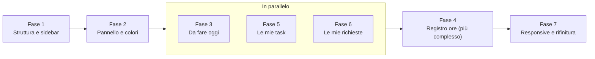

# Piano di redesign della dashboard

11 novembre 2026

## Obiettivo e contesto

La nuova dashboard porta su un'unica schermata, senza scorrere, tutto quello che serve nella giornata: cosa devo fare, cosa ho fatto, le mie task per priorità e lo stato delle mie richieste.

Oggi il lavoro è tracciato tra BIpro e Mattermost. Il gestionale lo sostituisce: ogni persona registra le attività del giorno su un calendario, chiede ferie e vede le proprie task come card e su calendario.

La dashboard attuale è una colonna unica centrata, con dall'alto verso il basso:

1. 4 card orizzontali: lavori urgenti, da fare oggi, da fare in settimana, in corso
2. calendario delle cose da fare oggi
3. calendario da aggiornare con quanto fatto oggi
4. lista delle proprie task

Il limite è che tutto sta in fila: per arrivare alle task bisogna scorrere oltre due calendari, e i lati dello schermo restano vuoti. Il redesign usa la larghezza dello schermo e aggiunge una navigazione laterale comune a tutta l'app.

## Struttura del nuovo layout

Lo schermo si divide in tre zone affiancate: sidebar a icone, colonna principale con i due calendari (circa 60% dello spazio) e colonna destra con task e richieste (circa 40%).

```text
┌──────────────┐ ┌────────────────────────────────────┐ ┌────────────────────────────┐
│ [ LOGO ]     │ │ Da fare oggi                       │ │ Le mie task      Vedi tutte│
│              │ │ sola lettura · ora corrente        │ │ per priorità e scadenza    │
│ Oggi         │ │                                    │ │                            │
│ Lavori       │ │   ▒▒▒▒▒▒▒▒▒▒▒▒▒▒▒                  │ │ ● ▒▒▒▒▒▒▒▒▒▒▒▒▒▒           │
│ Rich. ore    │ │   ▒▒▒▒▒▒▒▒▒▒▒▒▒▒▒▒▒▒▒▒▒▒           │ │ ● ▒▒▒▒▒▒▒▒▒▒▒▒▒▒           │
│ Assenze      │ │   ▒▒▒▒▒▒▒▒▒▒▒                      │ │ ● ▒▒▒▒▒▒▒▒▒▒▒▒▒▒           │
│ Rich. ass.   │ │                                    │ │                            │
│ Utenti       │ └────────────────────────────────────┘ └────────────────────────────┘
│              │ ┌────────────────────────────────────┐ ┌────────────────────────────┐
│              │ │ Cosa ho fatto oggi         5h / 8h │ │ Le mie richieste          +│
│              │ │ trascina per registrare le ore     │ │ ore e assenze insieme      │
│              │ │ copia dal pianificato              │ │                            │
│              │ │                                    │ │ ▒▒▒▒▒▒▒▒  (in attesa)      │
│ si espande   │ │   ▒▒▒▒▒▒▒▒▒▒▒▒▒▒▒▒▒                │ │ ▒▒▒▒▒▒▒▒  (approvata)      │
│ al passaggio │ │   [ + nuovo blocco ]               │ │ ▒▒▒▒▒▒▒▒  (rifiutata)      │
│ del mouse    │ │                                    │ │                            │
└──────────────┘ └────────────────────────────────────┘ └────────────────────────────┘
```

La colonna destra parte alla stessa altezza di "Da fare oggi", così agenda e task della giornata si leggono insieme senza scorrere.

Le 4 card attuali (urgenti, oggi, settimana, in corso) non spariscono: diventano contatori cliccabili nell'intestazione di "Le mie task" e filtrano la lista.

## Sidebar

La sidebar è una barra di icone larga circa 56px che si espande a circa 220px al passaggio del mouse, mostrando le etichette. Il logo sta in cima: da chiusa solo il simbolo, da aperta il logo completo.

Le voci sono definite in un unico file di configurazione (icona, etichetta, percorso, ruoli ammessi) e la sidebar mostra solo quelle del ruolo dell'utente.

| Voce | Icona suggerita | Admin | Dipendente |
| --- | --- | --- | --- |
| Oggi | sole o calendario del giorno | sì | sì |
| Lavori | valigetta | tutti i lavori | solo i propri |
| Richieste ore | orologio con matita | approva | invia |
| Assenze | ombrellone o aereo | calendario di tutti | solo le proprie |
| Richieste assenza | calendario con + | approva | invia |
| Utenti | gruppo di persone | sì | no |

Regole di comportamento:

- **Sovrapposizione, non spinta.** Da aperta la sidebar copre il contenuto invece di spostarlo, così i calendari non si ridimensionano a ogni passaggio del mouse.
- **Ritardo di apertura.** 150–200ms prima di aprirsi, per evitare aperture accidentali quando il mouse va verso il bordo.
- **Voce attiva evidenziata** con colore e sfondo leggero, visibile anche da chiusa.
- **Tastiera.** La sidebar si apre anche quando una voce riceve il focus, e ogni icona ha un'etichetta leggibile dagli screen reader.
- **Touch.** Su tablet l'hover non esiste: un tocco sul logo o su un pulsante apre e chiude la barra.
- **Sicurezza.** Nascondere una voce non basta: le stesse regole sui ruoli vanno applicate alle rotte del frontend e soprattutto alle API del backend.

## Fasi di sviluppo

Sette fasi, ognuna con le attività da spuntare e un criterio che dice quando è finita.

### Fase 1 — Struttura dell'app e sidebar

- [ ] Creare il layout a griglia: sidebar, colonna principale (circa 60%), colonna destra (circa 40%)
- [ ] Creare il file di configurazione delle voci con i ruoli ammessi
- [ ] Costruire la sidebar con logo, icone, espansione in sovrapposizione e ritardo di apertura
- [ ] Evidenziare la voce attiva in base alla rotta corrente
- [ ] Proteggere le rotte per ruolo nel frontend e verificare che il backend faccia lo stesso

**Fatto quando:** admin e dipendente vedono voci diverse, e un dipendente che digita l'URL di Utenti non accede alla pagina.

### Fase 2 — Pannello riutilizzabile e colori

- [ ] Creare un componente pannello con intestazione (titolo e azioni), corpo e stati di caricamento, vuoto ed errore
- [ ] Definire i colori delle priorità: urgente, alta, media, bassa
- [ ] Definire i colori degli stati delle richieste: in attesa, approvata, rifiutata

**Fatto quando:** i quattro blocchi della dashboard usano lo stesso pannello e gli stessi colori, e ogni stato ha un aspetto definito.

### Fase 3 — Calendario "Da fare oggi"

- [ ] Vista giornaliera in sola lettura dei lavori pianificati
- [ ] Ore visibili limitate all'orario lavorativo (per esempio 8–19) con scorrimento interno
- [ ] Scorrimento automatico all'ora corrente e linea sull'orario attuale
- [ ] Clic su un evento apre il dettaglio del lavoro

**Fatto quando:** all'apertura si vede subito l'ora corrente e ogni evento porta al suo lavoro.

### Fase 4 — Calendario "Cosa ho fatto oggi"

- [ ] Creare un blocco trascinando su uno spazio vuoto
- [ ] Ridimensionare un blocco dai bordi e spostarlo
- [ ] Modificare un blocco al clic e collegarlo a un lavoro
- [ ] Contatore ore registrate su ore previste (per esempio 5h / 8h), verde a giornata completa
- [ ] Pulsante "Copia dal pianificato" che trasforma gli eventi di "Da fare oggi" in blocchi registrati
- [ ] Stessa scala oraria e stessa larghezza del calendario sopra

**Fatto quando:** una giornata tipica si registra in meno di un minuto partendo da "Copia dal pianificato".

### Fase 5 — Le mie task

- [ ] Ordinare per priorità, poi per scadenza, con le scadute sempre in cima
- [ ] Riga con indicatore di priorità, titolo, lavoro o cliente, scadenza breve ("oggi", "ieri", "ven")
- [ ] Mostrare al massimo 6–8 task con link "Vedi tutte" verso Lavori
- [ ] Contatori cliccabili in intestazione (urgenti, oggi, settimana, in corso) che filtrano la lista e sostituiscono le vecchie 4 card

**Fatto quando:** la task più urgente è sempre la prima riga e i contatori corrispondono ai numeri delle vecchie card.

### Fase 6 — Le mie richieste

- [ ] Lista unica di richieste ore e assenze, distinte da un'icona
- [ ] In cima quelle in attesa, sotto quelle chiuse negli ultimi 30 giorni
- [ ] Etichetta colorata dello stato su ogni riga
- [ ] Pulsante "+" per creare una nuova richiesta senza cambiare pagina
- [ ] Vista admin: "Richieste da approvare" con approva e rifiuta sulla riga

**Fatto quando:** un dipendente vede a colpo d'occhio se ha richieste in attesa, e l'admin approva senza uscire dalla dashboard.

### Fase 7 — Responsive e rifinitura

- [ ] Sotto circa 1200px la colonna destra scende sotto i calendari
- [ ] Su smartphone la sidebar diventa barra in basso o menu a scomparsa
- [ ] Verifica contrasto colori e navigazione da tastiera
- [ ] Caricamento dei quattro pannelli in parallelo e indipendente

**Fatto quando:** la dashboard è usabile su desktop, tablet e smartphone, e un errore in un pannello non blocca gli altri.

## Ordine di lavoro

Si parte dalla struttura perché la usano tutte le pagine; il calendario modificabile arriva dopo "Da fare oggi" perché ne riusa scala oraria e componenti.

**Fase 1 → Fase 2 → (Fasi 3, 5, 6 in parallelo) → Fase 4 → Fase 7**



Le fasi 3, 5 e 6 non dipendono l'una dall'altra e possono procedere insieme, così la dashboard è utilizzabile presto. La Fase 7 chiude quando tutti i blocchi esistono.

## Decisioni aperte

- [ ] Tecnologia del frontend (React, Vue, Angular, altro) e libreria di calendario attuale: decide se riusare i componenti esistenti o sostituirli
- [ ] Ore previste per giornata: fisse (8h) o diverse per persona e contratto?
- [ ] Le richieste ore sono straordinari, correzioni o altro? Serve per scegliere icone ed etichette
- [ ] Voci della sidebar per il dipendente: confermare l'elenco della tabella Sidebar
- [ ] Per l'admin il blocco destro mostra "Le mie richieste", "Richieste da approvare" o entrambi?
- [ ] Su smartphone: barra in basso o menu a scomparsa?
- [ ] Logo: serve una versione simbolo per la sidebar chiusa?
